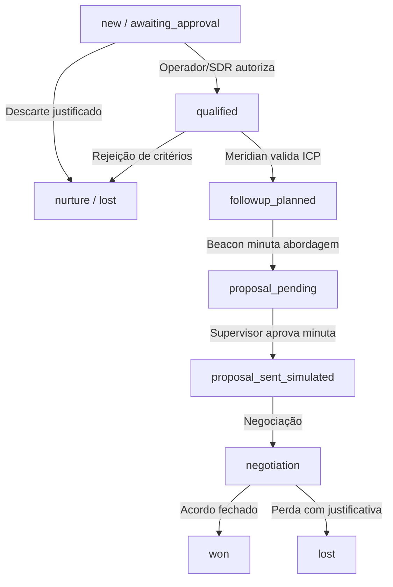

# Onda 11 — Arquitetura do Encadeamento Comercial

## 1. Princípios de Governança Comercial
1. **Empresa Importada ≠ Lead Interessado**: Empresas prospectadas via Scout são contas-alvo frias (`target`), não contatos qualificados.
2. **Sem Contatos Fictícios**: É expressamente proibido forjar pessoas, e-mails pessoais ou números de telefone artificiais. A prospecção opera no nível institucional (`Company` / `Opportunity`).
3. **Sem Claims Não Validados**: Propostas de abordagem (Beacon) utilizam unicamente alegações comerciais (`OfferClaim`) aprovadas pelo time de produto/compliance.
4. **Isolamento de Tenant**: Todo registro está vinculado a `workspaceId`, com RBAC granular e verificação em camada de aplicação e banco.

## 2. Máquina de Estados da Oportunidade (`OpportunityStage`)
O ciclo de vida comercial da oportunidade obedece a transições estritas:

### Regras de Transição Válidas
- `new` → `awaiting_approval`, `qualified`, `nurture`, `lost`
- `awaiting_approval` → `qualified`, `nurture`, `lost`
- `qualified` → `followup_planned`, `nurture`, `lost`
- `followup_planned` → `proposal_pending`, `nurture`, `lost`
- `proposal_pending` → `proposal_sent_simulated`, `lost`
- `proposal_sent_simulated` → `negotiation`, `lost`
- `negotiation` → `won`, `lost`
- `nurture` → `qualified`, `lost`
- `won` → (terminal)
- `lost` → `nurture` (revisão)

Qualquer transição exige fornecimento obrigatório de justificativa (`reason`), que é persistida de forma append-only em `OpportunityHistory` e replicada no `AuditEvent`.

## 3. Proveniência e Rastreabilidade
A entidade `Opportunity` preserva:
- `companyId`: Vínculo direto com a empresa aprovada na Central Scout.
- `dossierId`: Referência ao dossiê de prospecção e evidências levantadas pelo Scout.
- `batchId`: Identificador do lote CSV de origem.
- `icpScore` e `evidence`: Pontuação heurística de aderência e justificativas originais.
- `correlationId`: Rastreabilidade fim-a-fim entre a importação, promoção, missões dos agentes e aprovações humanas.
