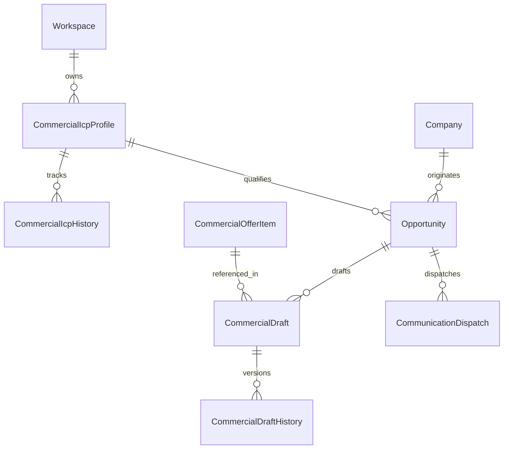

# Arquitetura e Modelo de Domínio — Onda 12
**Birthub Growth Office — Operação Comercial Integrada**

## 1. Visão Geral
A Onda 12 evoluiu o Birthub Growth Office em quatro pilares fundamentais:
1. **ICP Comercial Dinâmico e Versionado:** Critérios configuráveis de qualificação com pesos, inclusões, exclusões e histórico imutável.
2. **Ativação e Estado Honesto de IA (Meridian):** Operação sob rubrica determinística e schema estrito, com status explícito de bloqueio por credencial quando ausente chave real.
3. **Sandbox de Comunicação Comercial Supervisionada:** Simulação completa de cenários de entrega, opt-out, supressão e idempotência estrita sem realizar chamadas externas reais.
4. **Governança da Oferta Comercial:** Catálogo canônico de alegações aprovadas, bloqueando o uso de alegações pendentes de validação ou não auditadas.

## 2. Diagrama de Relacionamento de Entidades (ERD)

## 3. Novos Modelos no Schema Prisma (`prisma/schema.prisma`)
- **`CommercialIcpProfile`:** id, workspaceId, name, version, status (`draft`, `pending_approval`, `approved`, `archived`), targetSegments, targetCnaes, targetSizes, targetUfs, inclusions (JSON), exclusions (JSON), weights (JSON), changeReason, approvedBy, approvedAt, createdBy, createdAt, updatedAt.
- **`CommercialIcpHistory`:** id, profileId, action, actor, reason, details (JSON), occurredAt.
- **`CommunicationDispatch`:** id, workspaceId, draftId, opportunityId, channel, recipient, subject, content, status (`sent_simulated`, `error_simulated`, `blocked_suppressed`, `blocked_unauthorized`), simulated (`true`), errorReason, dispatchedBy, correlationId, createdAt.
- **`CommercialOfferItem`:** id, workspaceId, category (`value_prop`, `feature`, `differentiator`, `target_audience`, `contract_term`, `objection_response`), title, content, evidenceUrl, status (`approved`, `pending_validation`, `rejected`, `archived`), version, approvedBy, approvedAt, createdBy, createdAt, updatedAt.
- **`CommercialDraftHistory`:** id, draftId, version, text, subject, channel, claimRefs, changedBy, changeReason, occurredAt.

## 4. Isolamento e Transações Atômicas
Todas as mutações críticas utilizam transações atômicas com append-only de eventos de outbox (`EventOutbox`) e trilhas de auditoria (`AuditEvent`), assegurando rastreabilidade ponta a ponta sem vazamento de estado entre workspaces.
