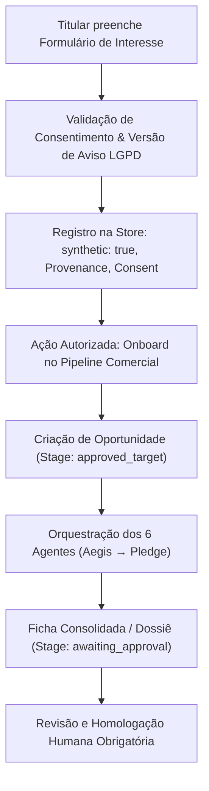

# Jornada do Piloto Comercial Supervisionado — Onda 13
## Captação, Consentimento LGPD e Onboarding no Pipeline (G173, G174)

### 1. Arquitetura da Jornada de Entrada
A jornada comercial do piloto supervisionado estabelece uma fronteira clara e intransponível entre:
1. **Empresas Alvo Outbound (Scout)**: Organizações mapeadas por CNAE e porte a partir de fontes públicas, sem evidência prévia de interesse comercial.
2. **Leads Voluntários Inbound (Piloto Comercial)**: Titulares ou representantes corporativos que expressamente preenchem formulário solicitando demonstração, apresentação ou proposta sobre o Birthub 360°.

---

### 2. Ciclo de Vida do Lead Voluntário



---

### 3. Campos Mandatórios e Preservação de Proveniência

Ao realizar o onboarding de um lead voluntário através do endpoint `POST /api/leads/:id/onboard-opportunity`, os seguintes atributos são rigorosamente preservados:
- **`originLeadId`**: Referência imutável ao identificador único do lead.
- **`provenance`**:
  - `source`: Canal de origem (ex.: `"formulario_web_piloto"`).
  - `at`: Timestamp ISO de submissão.
  - `legalBasis`: Base legal LGPD (`"consentimento_titular_art_7_I_lgpd"`).
- **`consent`**:
  - `channel`: Canal expressamente autorizado para contato (`"email"`).
  - `optIn`: `true`.
  - `at`: Data e hora da manifestação de vontade.
- **`privacy`**:
  - `noticeVersion`: Versão do aviso de privacidade apresentado (ex.: `"aviso_privacidade_v2026_1"`).
  - `acceptedAt`: Data e hora de aceite dos termos.
  - `channels`: Canais permitidos.
  - `marketingOptIn`: Flag de autorização para comunicações institucionais.

---

### 4. Salvaguardas contra Violação de Privacidade
- **Tratamento de Opt-Out**: Se o lead possuir status `suppressed` ou carimbo `suppressedAt`, o método `onboardVoluntaryLead` bloqueia sumariamente o onboarding com exceção explícita:
  ```
  Lead com opt-out/suprimido não pode ingressar no pipeline comercial: <leadId>
  ```
- **Sem Envio Automático de Mensagens**: O onboarding e a geração do rascunho pelo Beacon não disparam nenhum e-mail ou mensagem externa. O rascunho gerado aguarda decisão humana na Central de Aprovações.
