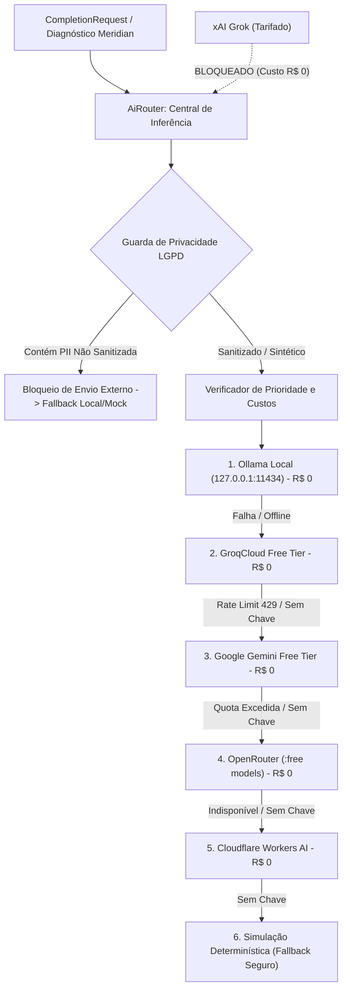

# Onda 14 — Relatório 02: Arquitetura Multiprovedor e Barramento de Inferência

**Projeto:** Birthub Growth Office (BGO)  
**Módulo:** `packages/ai` e `@bgo/contracts`  
**Data:** 14 de Novembro de 2026  

---

## 1. Princípios de Design

A arquitetura de IA da Onda 14 foi concebida sob o paradigma de **Roteamento Inteligente com Resiliência em Camadas**:



---

## 2. Componentes da Arquitetura

### 2.1 Interface Universal `ProviderAdapter`
Todo provedor implementa um contrato estrito em TypeScript:
```typescript
export interface ProviderAdapter {
  readonly id: string;
  readonly name: string;
  readonly type: AiProviderType;
  readonly isLocal: boolean;
  readonly costTier: AiCostTier;
  readonly defaultModel: string;
  getStatus(): Promise<AiProviderStatus>;
  getAvailableModels(): Promise<string[]>;
  complete(req: CompletionRequest): Promise<Omit<CompletionResult, "promptKey" | "promptVersion" | "simulated">>;
}
```

### 2.2 Provedores Catalogados
1. **Ollama Local (`ollama`)**: Prioridade máxima. Execução no hardware do host via loopback `127.0.0.1:11434`. Custo financeiro zero.
2. **GroqCloud (`groq`)**: Provedor cloud gratuito. Modelo `llama-3.1-8b-instant`. Limite de 30 RPM / 14.400 RPD.
3. **Google Gemini (`gemini`)**: Free tier oficial. Modelo `gemini-1.5-flash`. Limite de 15 RPM / 1.500 RPD.
4. **OpenRouter (`openrouter`)**: Modelos `:free` garantem custo R$ 0 (`meta-llama/llama-3.2-3b-instruct:free`). Modelos pagos são barrados programaticamente.
5. **Cloudflare Workers AI (`cloudflare`)**: Franquia de 10.000 neurônios/dia (`@cf/meta/llama-3.1-8b-instruct`).
6. **xAI Grok (`xai`)**: Provedor tarifado. Bloqueado por padrão sob política R$ 0. Exige flag explícita `XAI_AUTHORIZED_SPEND=1`.
7. **Simulação Determinística (`mock`)**: Rede de segurança final. Garante que nenhuma tela ou teste quebre caso todas as redes externas e locais estejam fora.

---

## 3. Registro Central e Endpoints da API

A camada de API em `apps/api/src/app.ts` expõe a gestão de provedores:

- `GET /api/ai/providers`: Retorna a lista dos 7 provedores, status em tempo real, hardware e políticas de segurança. Segredos e chaves nunca são expostos.
- `POST /api/ai/providers/:id/test`: Realiza um teste sintético pontual com medição de latência.
- `POST /api/ai/providers/priority`: Permite que operadores reordenem a prioridade de fallback (bloqueado para auditores).
- `GET /api/ai/history`: Log append-only das inferências executadas.
- `POST /api/ai/meridian-diagnose`: Diagnóstico comercial com seleção de provedor e salvaguardas de claims.
